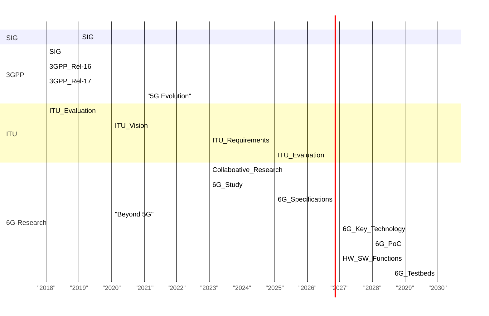

# 6G Networks

Introduction to 6G Networks

https://marp.app/

---
# Agenda

1. Introduction to 6G Networks
2. Key Features of 6G
3. Applications of 6G
4. Challenges and Opportunities
5. Conclusion

---

# What is 6G?

- **6G** refers to the sixth generation of wireless technology.
- It's the successor to the current 5G networks.
- Envisions revolutionary advancements in communication technology.

---

---
# Bridging Tesla's Vision with 6G

- Nikola Tesla foresaw wireless technology transforming the world into a "huge brain" in 1926.

----

- **Role of 6G:**
  - Expected to play a significant role in realizing Tesla's prophecy.
  - Providing an ICT infrastructure to enable this advancement.

- **Integration with ICT Advancements:**
  - Leveraging expected advancements in Information and Communication Technologies (ICT).

- **Tesla's Legacy:**
  - Continues to inspire technological innovation, including the development of 6G networks.

---
# Evolution Beyond 5G: Towards 6G Networks

- **5G Advancements:**
  - Breakthrough in communication networks.
  - Enables diverse services: enhanced mobile broadband, virtual reality, IoT, etc.

- **Anticipating Future Needs:**
  - Increasing demand for new services.
  - Prediction of new technologies within a decade.

---
- **Need for 6G Networks:**
  - Envisioned to address gaps in 5G.
  - Incorporate new technologies for individual and societal needs.

- **Key Considerations for 6G:**
  - Holographic communications, high precision manufacturing.
  - Integration of AI and emerging technologies like sub-THz and VLC.
  - 3D coverage framework with terrestrial and aerial access points.

---

## Key Features of 6G

1. **Extreme Speeds:**
   - Anticipated to be exponentially faster than 5G.
   - Supporting data rates up to **1 terabit per second**.

2. **Ultra-Low Latency:**
   - Targeting latency as low as **1 millisecond**.
   - Crucial for real-time applications like remote surgery and autonomous vehicles.

----

3. **Massive Connectivity:**
   - Supporting **trillions** of connected devices per square kilometer.
   - Enabling the Internet of Things (IoT) on an unprecedented scale.

4. **Energy Efficiency:**
   - Optimized to consume minimal energy per transmitted bit.
   - Promotes sustainability and longer device battery life.

---

# Future of Remote Interaction

- **Future of Remote Interaction:**
  - Current methods becoming obsolete.
  - Emergence of new interaction forms for true immersion.

---

# Slide 3: Holographic Communication

- **Holographic Communication:**
  - Utilizes multiple view cameras.
  - Demands data rates in the order of Tbps.

---
# Slide 4: Immersive Experience

- **Immersive Experience:**
  - Provides a truly immersive environment.
  - Enhances engagement and realism.

---
# Slide 5: Beyond 5G

- **Beyond 5G:**
  - Not supported by current 5G networks.
  - Highlights the need for advancements like 6G.

---
# Five Dimensions (5D) Communications

- **Five Dimensions (5D) Communications:**
  - Integration of all human senses: sight, hearing, touch, smell, and taste.
  - Expected to revolutionize immersive experiences.

---
## Applications of 6G

1. **Augmented Reality (AR) and Virtual Reality (VR):**
   - Seamless integration of virtual objects into the physical world.
   - Enhanced immersive experiences with real-time interactions.

2. **Healthcare:**
   - Facilitating remote surgeries with near-zero latency.
   - Supporting advanced telemedicine applications.

----

3. **Autonomous Vehicles:**
   - Enabling real-time communication between vehicles and infrastructure.
   - Enhancing safety and efficiency in transportation systems.

4. **Smart Cities:**
   - Optimizing urban infrastructure with interconnected sensors and systems.
   - Improving public services, transportation, and resource management.

---
# High-Precision Manufacturing

## Slide 1:

- **Objective of Industry 4.0:**
  - Reduce human intervention in industrial processes.
  - Utilize automatic control systems and communication technologies.

## Slide 2:

- **Numerical Objectives:**
  - Very high reliability, up to the order of 10^-9.
  - Extremely low latency, in the order of 0.1 to 1 millisecond (ms) round trip time.

## Slide 3:

- **Real-Time Data Transfer:**
  - Industrial control networks require real-time data transfer.
  - Strong determinism to ensure accuracy and reliability.

## Slide 4:

- **Low Delay Jitter:**
  - Very low delay jitter, in the order of 1 μsec.
  - Ensures consistent and predictable performance.

## Slide 5:

- **Implications for Manufacturing:**
  - Enhances efficiency and precision in manufacturing processes.
  - Enables advanced automation and optimization in Industry 4.0.

---
# Sustainable Development and Smart Environments

## Slide 1:

- **Role of ICT Technologies:**
  - Expected to drive global sustainability and improve quality of life.
  - Incorporating wireless communications, cloud computing, and IoT.

## Slide 2:

- **Impact on Health Care:**
  - ICT can greatly improve healthcare services.
  - Enables the development of smart cities and intelligent transportation systems.

## Slide 3:

- **Importance of Pervasive Sensing:**
  - Necessary for distributed decision-making and actuation systems.
  - 6G will provide 3D communication platforms for edge cloud functionalities.

## Slide 4:

- **Safety Mechanisms in Autonomous Driving:**
  - Requires very high communication reliability (>99.9999) and low latency (<1 ms).
  - Inter-communication between vehicles crucial for accident prevention.

## Slide 5:

- **Energy Efficiency in 6G:**
  - Focus on developing energy-efficient communication strategies.
  - Aim to achieve battery-free communications and communication efficiency of 1 pJ/bit.

---

| Aspect                   | 5G                                    | 6G                                     |
|--------------------------|---------------------------------------|---------------------------------------|
| Speed and Data Rates     | Offers high-speed data rates, up to several gigabits per second. | Anticipated to be exponentially faster, with data rates up to 1 terabit per second. Enables even more data-intensive applications and services. |
| Latency                  | Achieves low latency, typically in the range of 1 to 10 milliseconds. Suitable for real-time applications like gaming and video streaming. | Aims for ultra-low latency, as low as 1 millisecond or even less. Critical for emerging applications such as remote surgery and autonomous vehicles. |
| Connectivity and Capacity | Supports massive connectivity, connecting millions of devices per square kilometer. Enables the Internet of Things (IoT) and smart city applications. | Targets trillions of connected devices per square kilometer. Facilitates unprecedented levels of connectivity for advanced IoT and industrial applications. |
| Energy Efficiency        | Optimized for energy efficiency, but still consumes considerable power. Promotes sustainability with improved energy consumption compared to previous generations. | Aims for even greater energy efficiency, with optimized protocols and technologies. Strives for minimal energy consumption per transmitted bit, targeting sustainability and longer battery life. |
| Applications and Innovation | Enables a wide range of applications including augmented reality, virtual reality, and autonomous vehicles. Drives innovation across various industries with faster speeds and lower latency. | Envisions revolutionary applications like holographic communication and pervasive artificial intelligence. Sets the stage for groundbreaking innovations in healthcare, transportation, and beyond. |

---

## Challenges and Opportunities

### Challenges

- **Technological Hurdles:**
  - Overcoming technical limitations to achieve desired speeds and latency.
  - Developing new materials and technologies for infrastructure.

- **Regulatory and Security Concerns:**
  - Addressing privacy, security, and ethical implications of pervasive connectivity.
  - Establishing international standards and regulations.

----

### Opportunities

- **Innovation and Economic Growth:**
  - Fostering innovation in various industries, leading to economic growth.
  - Creating new business opportunities and job markets.

- **Global Connectivity:**
  - Bridging the digital divide by providing high-speed internet access worldwide.
  - Empowering underserved communities and facilitating global collaboration.

---

## Conclusion

- **6G** represents the next frontier in wireless communication.
- With its unprecedented speed, low latency, and massive connectivity, it promises to revolutionize various industries.
- Overcoming challenges and leveraging opportunities will be crucial in realizing the full potential of 6G networks.
